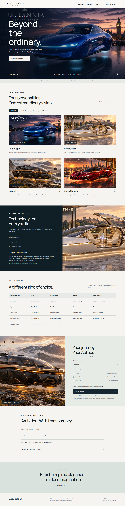

# Britannia Aether

British-inspired automotive concept showroom, built with HTML, CSS and vanilla JavaScript.

[Visit the showroom](https://rajakokila-p.github.io/britannia-aether-showroom/) · [Architecture](docs/architecture.md) · [Testing](docs/testing.md)



## About

Explore Aether Sport, Windsor Halo, Nomad and Albion Phoenix through model filters, detailed dialogs, technology panels and a personal concept configurator. The site includes a comparison table, downloadable concept briefs, a UK legal information page and clearly labelled sample contact details.

These are fictional vehicle designs, not production cars. No orders, reservations, payments or road-approval claims are made. Social channels link to accounts supplied by the project creator. Company details are illustrative, not verified registration information.

## Technology

- Semantic HTML, responsive CSS and vanilla JavaScript
- Browser-local interactions and text-file downloads
- Native dialogs and keyboard-accessible controls
- Google Fonts (external font requests)
- Public static hosting through GitHub Pages
- No custom backend, customer database or payment processing

## Repository structure

```text
.github/workflows/check.yml  Automated source checks
site/
  index.html                Main showroom
  legal.html                Company and UK legal guidance
  style.css                 Responsive styles
  app.js                    Browser interactions
  assets/                   Creator-supplied vehicle images
docs/
  architecture.md           Architecture and publishing pipeline
  testing.md                Validation record and limits
  contact-preview.png       Sample contact section
  showroom-preview.png      Earlier showroom overview
scripts/check.py            Internal references and content checks
```

## Run locally

Install Python 3, then run from the repository root:

```sh
python -m http.server 8000 --directory site
```

Open http://localhost:8000. No frontend build step or package installation is required. Internet access is needed for Google Fonts and external reference links.

## Validate

With Python 3 and Node.js installed:

```sh
python scripts/check.py
node --check site/app.js
```

GitHub Actions runs these checks on pushes and pull requests. Browser interaction testing is documented separately; passing source checks does not certify accessibility or legal compliance.

## Deployment

The `.github/workflows/pages.yml` pipeline validates the source, uploads the `site/` directory and deploys it to GitHub Pages on pushes to `main`. Repository Pages settings use GitHub Actions as the publishing source. The public address is https://rajakokila-p.github.io/britannia-aether-showroom/.

Architecture and testing documentation are available in `docs/` on GitHub. The original Sites deployment remains separate and is not updated by this pipeline. Downloaded concept briefs link to the legal page on the current host.

## Legal information and sample data

The legal page links to GOV.UK guidance covering company disclosures, vehicle approval, driver obligations, online sales, consumer rights, advertising and data protection. Sources were checked on 23 October 2026. It is an informational summary, not a legal-compliance certification or complete sales contract.

Replace fictional company and contact details with verified information before using the website for real trading. The project email links to spraja110880.rk@gmail.com through mailto; replies are handled manually, with no backend or automatic response service. The telephone number is from Ofcom's fictional range.

## Credits

Vehicle concepts and images were supplied by the project creator. Website code and documentation were developed with OpenAI Codex assistance. Google Fonts supplies DM Sans and Manrope. Government and Ofcom pages are linked as reference sources, without implying endorsement.

No open-source licence has been selected for this project. Repository availability does not grant additional reuse rights to its code, branding or imagery.
