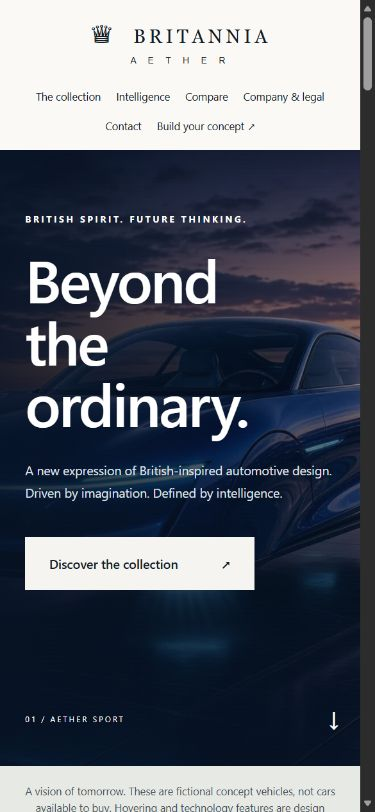

# Britannia Aether
British-inspired fictional automotive concept showroom for a university project. Built with semantic HTML, CSS and vanilla JavaScript. No vehicles, orders, payments or road approval are offered.

## Desktop and mobile screenshots

Captured from the live GitHub Pages homepage on 27 October 2026 using Edge with responsive viewport overrides. These show the initial page view, not a complete accessibility or cross-browser test. The mobile image is a narrow browser viewport, not a physical-device capture.

### Desktop view — 1440 × 1000 CSS-pixel viewport


### Mobile view — 390 × 844 CSS-pixel viewport



[Open the live showroom](https://rajakokila-p.github.io/britannia-aether-showroom/)

## All 15 project areas

All 15 areas are addressed below. “Not applicable” means the system is not implemented because this static showroom does not require it. It does not mean a working backend or AI service is included.

| # | Area | Document | Current scope |
| --- | --- | --- | --- |
| 1 | Product requirements | [PRD.md](docs/PRD.md) | Documented for static showroom |
| 2 | Design | [DESIGN.md](docs/DESIGN.md) | Documented and implemented in CSS/HTML |
| 3 | Architecture | [ARCHITECTURE.md](docs/ARCHITECTURE.md) | Static data flow and delivery documented |
| 4 | Database/backend | [DATABASE.md](docs/DATABASE.md) | Not applicable; local data model documented |
| 5 | API | [API.md](docs/API.md) | No application API; browser contracts documented |
| 6 | Agents/coding rules | [../AGENTS.md](AGENTS.md) | Coding rules included; runtime agents not applicable |
| 7 | README | [../README.md](README.md) | Current entry point and handoff |
| 8 | Implementation plan | [PLAN.md](docs/PLAN.md) | Dependencies, priorities and release steps |
| 9 | Setup | [SETUP.md](docs/SETUP.md) | Preview, validation and development dependencies |
| 10 | Features | [FEATURES.md](docs/FEATURES.md) | Source mapping and acceptance behavior |
| 11 | Authentication/security | [AUTHENTICATION.md](docs/AUTHENTICATION.md) | Public access decision and trust boundaries |
| 12 | MCP | [MCP.md](docs/MCP.md) | Not applicable; rationale and future gate |
| 13 | Integrations | [INTEGRATIONS.md](docs/INTEGRATIONS.md) | Actual connections and failure boundaries |
| 14 | Testing/QA | [TESTING.md](docs/TESTING.md) | Repeatable suite plus manual coverage |
| 15 | Debugging | [DEBUGGING.md](docs/DEBUGGING.md) | Diagnosis, recovery and report template |

## Start here

- [All 15 areas](docs/COVERAGE.md): current documentation and explicit not-applicable decisions.
- [Requirements](docs/PRD.md), [design](docs/DESIGN.md), [architecture](docs/ARCHITECTURE.md).
- [Setup](docs/SETUP.md), [testing](docs/TESTING.md), [fresh verification](docs/VERIFICATION.md), [debugging](docs/DEBUGGING.md).

## Features
Explore Aether Sport, Windsor Halo, Nomad and Albion Phoenix; filter editions; open detail dialogs; switch technology panels; compare concepts; configure edition/cabin mood and download a local text brief. Contact prepares an email draft that the visitor must send manually. No enquiry is submitted to a server or saved by the website.

## Structure
site/index.html is the showroom homepage; site/showroom.html is its compatibility alias. site/portfolio.html is separate and not linked from the homepage navigation. site/showroom-case-study.html explains the implemented website. site/legal.html contains disclosures. site/app.js and contact.js handle browser behavior; assets/ holds supplied images. docs/ contains current specifications and labelled historical reports. scripts/ contains source/document checks; tests/ contains browser tests. .github/workflows/ retains source checks and Pages deployment.

## Run
```sh
python -m http.server 8000 --directory site
```
Open http://localhost:8000. No application build or package installation is required. Use `py` on Windows if necessary.

## Validate
```sh
python scripts/check.py
python scripts/check_docs.py
node --check site/app.js
node --check site/contact.js
```
For optional development-only browser dependencies and `node tests/browser.cjs`, see SETUP.md. Source checks alone do not prove browser behavior or accessibility.

## Scope and privacy
No database, login, application API, AI-agent runtime, MCP, analytics, automatic email or payment service is installed. The 15-area documentation explains those decisions. GitHub Pages serves public files and may process hosting logs. Vehicle images are speculative AI-generated imagery supplied by the creator. Mood selections do not render new images. Business address/phone details are fictional samples. Legal information is not a compliance certification.

## Contributing and roadmap
Read AGENTS.md and PRD.md, make a focused change, keep both showroom routes consistent, run validation and browser checks, then update affected documentation. Report bugs using DEBUGGING.md. Remaining manual work includes cross-browser/assistive-technology review and external-link checks. Backend/AI expansions require new requirements. A résumé, custom domain and analytics are not required for this university site.

## Deployment and replacement
The existing Pages workflow publishes site/ on main after validation. This replacement archive updates project source only; it does not itself publish. Back up your existing project, extract this archive and use the included project folder as the replacement. If using Git, review the changes and retain your .git directory. Do not upload node_modules. A separate original Sites deployment is not changed by the GitHub workflow.

## Evidence and licence
Fresh results are in docs/VERIFICATION.md. Earlier dated Lighthouse reports remain historical and must not be presented as newly measured. No open-source licence has been selected; public availability does not grant additional reuse rights to code, branding or imagery.
