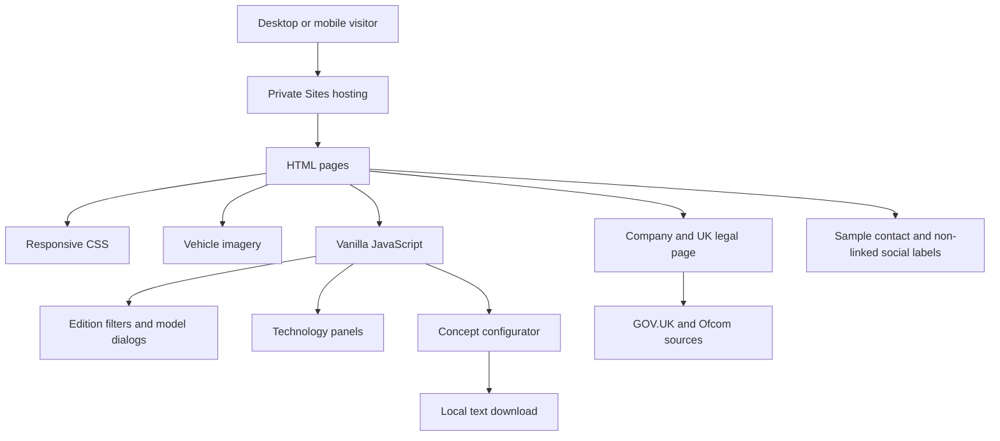
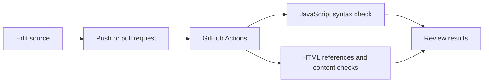

# Architecture and pipeline

## Current website

There is no custom application backend or database. The hosting provider may process access and authentication information. Google Fonts receives external requests. The configurator does not send selections to a sales service.

## GitHub validation pipeline

## Sites publication workflow

The GitHub and Sites repositories are separate. GitHub checks do not automatically deploy to Sites. Hosting identifiers, temporary credentials and machine-specific tooling are excluded from this source export.
