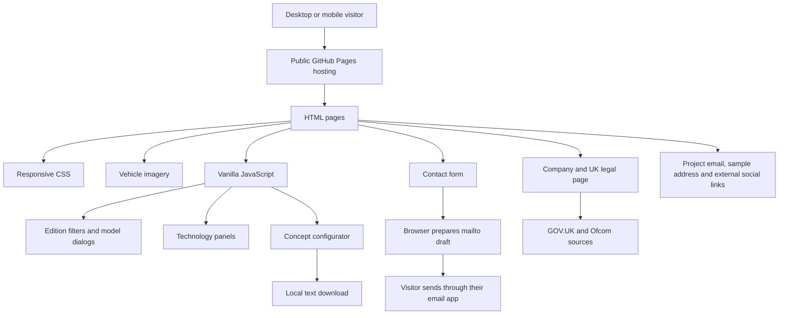
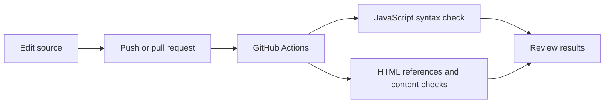
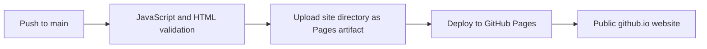

> Historical document retained for traceability. Current specification and coverage: [COVERAGE.md](COVERAGE.md). Current homepage is index.html (showroom); portfolio.html is separate. Résumé is intentionally excluded. Earlier audit scores are historical, not rerun by this update.

# Architecture and pipeline

## Current website

There is no custom application backend or database. The hosting provider may process access and authentication information. System fonts avoid external font requests. The configurator does not send selections to a sales service.

## GitHub validation pipeline

## GitHub Pages deployment pipeline

The `pages.yml` workflow publishes only after validation succeeds. It uses GitHub's Pages deployment token; no personal credentials are stored in the repository. Pages serves static files with no application backend or database. The architecture and testing documents remain in the GitHub `docs/` directory.

## Separate original Sites publication workflow

The GitHub and Sites repositories are separate. GitHub checks do not automatically deploy to Sites. Hosting identifiers, temporary credentials and machine-specific tooling are excluded from this source export.
